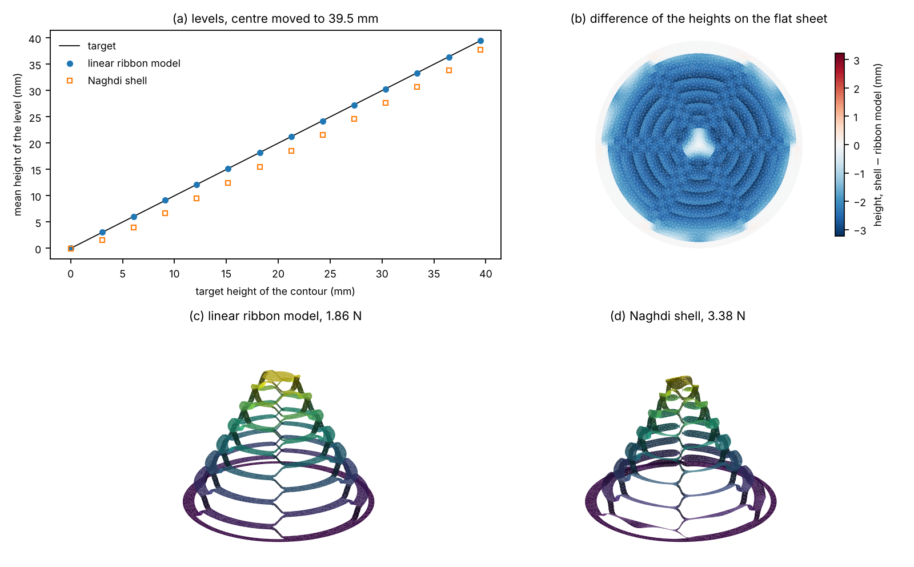
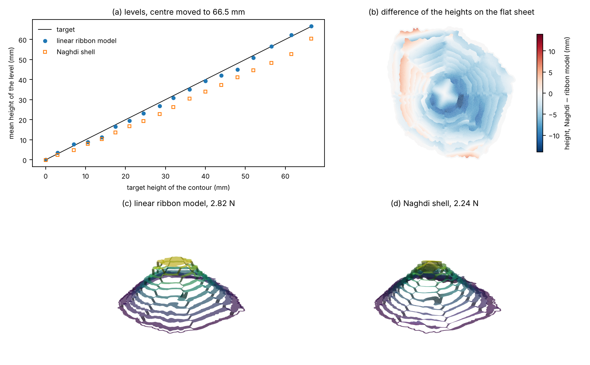

# FEM deployment with a nonlinear shell

This folder deploys the cut sheet of the main pipeline with a geometrically nonlinear shell finite-element model and compares the result with the linear ribbon model on the **same mesh**. Both are deployed by displacement: the rim is clamped and the centre of the top level is moved up to the height of its contour, with the force as an unknown.

The shell is the nonlinear Naghdi model of the FEniCSx-Shells demos (Hale et al. 2018), written out for DOLFINx 0.11:

- unknowns: the 3D displacement u (P2 enriched with a cubic bubble) and two director rotations θ (P2); the director is d(θ) = (sin θ₂ cos θ₁, −sin θ₁, cos θ₂ cos θ₁) and the reference is the flat sheet;
- strains: membrane ε = ½(FᵀF − I), bending κ = ½(Fᵀ∇d + ∇dᵀF), shear γ = Fᵀd, with F = ∇(φ₀ + u) (Naghdi 1972);
- energy: plane-stress St. Venant–Kirchhoff, ½ t A(ε):ε + ½ (t³/12) A(κ):κ + ½ t μ γ·γ;
- locking: partial selective reduced integration (PSRI, Arnold & Brezzi 1997), with the membrane and shear energy split by α = t²/h_K² and the (1 − α) part integrated with degree 2;
- solution: Newton (PETSc SNES, plain line search) with the MUMPS direct solver, in height steps. A step that fails is halved, and the step grows again when Newton converges in under 8 iterations.

The material is PET by default: E = 2.1 GPa, ν = 0.4, t = 0.1 mm (`--young`, `--poisson`, `--thickness`).

## Installation

The FEniCSx environment is separate from the one of the repository. With conda, mamba or micromamba:

```
conda env create -f fem_deployment/environment.yml
conda activate kirigami-fenicsx
```

Steps 1 and 3 run in the environment of the repository (libigl, triangle, shapely). Step 2 runs in the FEniCSx environment.

## Usage

```
# 1. cut sheet + ribbon model deployment -> fem_deployment/output/case_cone_h1.npz
python fem_deployment/export_case.py cone --h 1

# 2. Naghdi shell, by displacement of the centre (FEniCSx environment)
cd fem_deployment
python naghdi_deploy.py output/case_cone_h1.npz --steps 12
cd ..

# 3. comparison with the ribbon model
python fem_deployment/compare_ribbon.py fem_deployment/output/case_cone_h1.npz
```

Any STL/OBJ target is sliced as in `examples/04_deploy_stl.py`, for example the Mount Fuji tile scaled for the laser cutter:

```
python fem_deployment/export_case.py path/to/fuji.stl --scale 0.45 --zmin 4.5 --zmax 78.75 --delta 2 --step 0.5 --N 8 --h 1
python naghdi_deploy.py output/case_fuji_x0.45_h1.npz --steps 24 --flat-start
```

By default, the first guess of the shell is the ribbon model deployment. When the ribbon model is far from the shell, as for Fuji, Newton diverges from it, and `--flat-start` starts from the flat sheet instead.

| script | input | output |
|---|---|---|
| `export_case.py` | a target of `data/` or a mesh file | `case_<name>_h<h>.npz`: flat sheet, rim, centre, top height, ribbon model deployment and level motions |
| `naghdi_deploy.py` | the case | `<case>_naghdi.csv` (height, force, Newton iterations) and `<case>_naghdi_<step>.npy` (deformed vertices) for every step |
| `compare_ribbon.py` | the case and the shell run | `<case>_compare.csv` / `.png` (force and shape difference at every height), `<case>_levels.csv`, `<case>_vs_ribbon.png` (levels, height difference on the flat sheet, both deployed sheets) |
| `check_slit_plate.py` | `nr nt [steps] [nu]` | slit annular plate benchmark (Sze et al. 2004) |

The mesh should have at least 2 rows of triangles across the narrowest ribbon (`export_case.py` prints it). Mesh sizes of 1 mm and 0.5 mm change the cone force by about 15 % (3.38 and 2.93 N).

## Results

**Verification.** On the slit annular plate (8 × 80 mesh, 40 load steps, ν = 0), the tip deflections at q = 0.8 are w_A = 13.82 and w_B = 17.46, against the reference values 13.891 and 17.528 (Sze et al. 2004).

**Cone** (15 contours, N = 6, ribbons 1.75 mm, h = 1 mm, 4.7k vertices, about 3 min on 2 cores) at 39.5 mm:

| | ribbon model | Naghdi shell |
|---|---|---|
| force | 1.86 N | 3.38 N |
| level heights, rms difference | | 2.4 mm (shell below) |
| vertices, rms / max difference | | 2.7 / 3.7 mm |



**Mount Fuji ×0.45** (19 contours, N = 8, 53k vertices, about 4 h on 2 cores) at 66.5 mm: the force is 2.24 N for the shell against 2.82 N for the ribbon model. The vertices differ by 5.3 mm rms (14 mm at most), and the shell levels sit up to 9.5 mm below the ribbon model. The shell is softer than the ribbon model at small heights and stiffens strongly above about 50 mm, where the rise of a level approaches its ribbon length and the ribbons stretch.



The scripts run in serial (`MPI.COMM_SELF`); MUMPS uses the threads of the machine.

## References

- J. S. Hale, M. Brunetti, S. P. A. Bordas, C. Maurini (2018). Simple and extensible plate and shell finite element models through automatic code generation tools. *Computers & Structures* 209, 163–181.
- I. A. Baratta et al. (2023). DOLFINx: the next generation FEniCS problem solving environment. Zenodo, doi:10.5281/zenodo.10447666.
- P. M. Naghdi (1972). The theory of shells and plates. In *Handbuch der Physik* VIa/2, Springer, 425–640.
- D. N. Arnold, F. Brezzi (1997). Locking-free finite element methods for shells. *Mathematics of Computation* 66, 1–14.
- K. Y. Sze, X. H. Liu, S. H. Lo (2004). Popular benchmark problems for geometric nonlinear analysis of shells. *Finite Elements in Analysis and Design* 40, 1551–1569.
